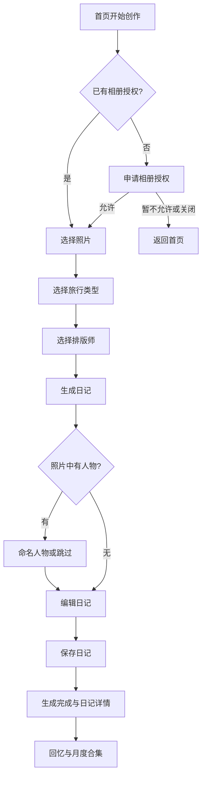

# 用户流程

本页以业务能力为口径串联用户目标，具体功能定义见模块规格。流程中存在的页面入口断点列入 Q-009，不能据此宣称当前所有链路已经可连续操作。

## J-01 从照片创建并收藏日记

关联：CRE-001～006、DIA-001～007。照片至少 3 张；保存前是独立草稿；新日记默认私密。生成尚未完成时不能保存新作品。人物命名为可选步骤，无人物直接编辑。

分支：用户离开创作/编辑可选择继续或放弃；离开生成页使本轮生成失效；新日记改整篇照片后需要重新生成。保存成功后新日记应可被首页最近日记、回忆和月度分组读取。

排版师也可作为创作入口：主页浏览排版师 → 选择 → 授权/照片 → 后续创作；该路径的角色保留与后续再选行为需要通过 Q-009 明确。

## J-02 找到日记并修改

回忆 → 月份/日期/关键词筛选 → 日记详情 → 编辑入口 → 修改标题/段落/引用照片/排版师 → 保存原日记。

关联：DIA-001～006。编辑使用副本，未保存修改不应影响原记录；保存沿用原日记 ID，放弃保留原文。当前详情“更多”直接进入公开范围，编辑菜单未由常规详情入口接入；链路补齐见 Q-009。跨日旅行的检索归属见 Q-004。

## J-03 控制公开内容并分享

已保存日记 → 选择私密/匿名公开/公开仅点赞/公开可评论 → 选择正文或引用句 → 保存公开范围 → 分享预览 → 平台分享或长图/PDF。

关联：SHR-001～005。非私密公开至少选择一段；分享内容及其关联照片、封面、摘要遵循同一范围。匿名时已知姓名与人物面容一起处理。私密作品允许本地预览、保存和导出，平台分享被拦截并引导调整范围。

“公开可评论”表达互动权限意图，评论编写、删除、审核等尚未形成当前功能；公开作品是否进入发现也未定义，见 Q-007。已公开作品修改、撤回后，链接与历史文件如何处理见 Q-013。

## J-04 将素材用于记录

素材库 → 添加/搜索照片 → 预览 → 选择目标日记 → 照片加入首段引用 → 编辑 → 保存。

素材库 → 贴纸或城市印章 → 预览 → 用于明信片；或照片素材 → 用于明信片 → 生成 → 分享/保存。

素材库 → 灵感卡 → 输入回答 → 转给小橘；或描述未拍摄的画面 → AI 补图 → 配图预览 → 用于日记/明信片。

关联：MAT-001～005、PCD-001～002、PET-001、DIA-003/005。真实上传、配图交付与明信片历史作品规则见 Q-015。

## J-05 获得陪伴和成长洞察

萌宠 → 与小橘聊天 → 查看记忆概览/锚点；我的 → 小橘眼中的你 → 成长树标签 → 锚点 → 原日记，或纠正锚点理解。

成长树 → 记忆花朵与里程碑 → 满足解锁条件 → 专属洞察报告。

关联：PET-001～002、GRW-001～006。锚点纠正目前覆盖锚点展示，不修改原日记。报告展示 3 朵花的解锁门槛；花朵获取、成长自动计算和报告更新规则尚待 Q-006，不能写成已完成的自动增长流程。

## J-06 阅读他人的故事

发现 → 推荐/同城/最新 → 关键词搜索 → 故事详情 → 点赞或取消。

关联：DSC-001～003。列表和详情共用点赞状态。发现内容与个人日记当前是不同的数据集合，“公开即进入发现”需要 Q-007 的业务决策。
